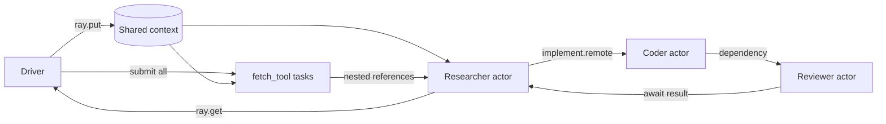

# 2. Combine Ray primitives into a workflow

Prerequisite: [1. Basics](../01_basics/README.md). This chapter combines those
primitives with three async actors. The personas are deterministic Python logic,
without an LLM or generated-code execution.

## Step 1: run the offline workflow

From the repository root with the environment active:

```bash
python 02_workflows/run.py
```

Expect `Approved 3/3 reports; sources 3/3`. Open `artifacts/run.json` to see
source text, generated report functions, review checks, shared context IDs, node
IDs, worker PIDs, and per-stage event times. Run outputs are ignored by Git.
For Colab, open [ray_lab.ipynb](ray_lab.ipynb), upload a repository zip, and run
its cells in order. The notebook includes the basic lessons first.

## Step 2: trace the data flow



Read these files in order:

| File | Focus |
| --- | --- |
| [cli.py](../src/gemma_ray/cli.py) | Initialize Ray, store context, submit sources once, start actors, collect results, shut down |
| [runtime.py](../src/gemma_ray/runtime.py) | Remote tools and direct messages between async actors |
| [tools.py](../src/gemma_ray/tools.py) | Pure Python fixture and HTTP processing |
| [personas.py](../src/gemma_ray/personas.py) | Build a report and validate syntax/evidence |

`Researcher.run()` receives a **list** of source references. Unlike a top-level
reference argument, nested references remain references. It uses
`await asyncio.gather(*source_refs)` to retrieve them. It then sends a message to
Coder and passes Coder's returned reference to Reviewer, which receives the
resolved implementation. Researcher awaits the review while its event loop can
handle other requests.

The three actors reserve zero logical CPUs for this small I/O exercise; each
fetch task reserves 0.25. Async actor methods yield at `await`, so requests can
interleave within one actor process. Blocking CPU work inside an async method
would block that event loop. See [async actors](https://docs.ray.io/en/latest/ray-core/actors/async_api.html).

## Step 3: change concurrency and inspect reuse

```bash
python 02_workflows/run.py --jobs 6 --delay 0.5
```

Expect six results but still only three source records. All source `context_id`
values match `report.context.context_id`, and each actor has six history events.
Compare `started_at` / `finished_at` across Researcher events to see requests
overlap. `--jobs` counts topic requests, not Ray Jobs submissions or worker nodes.

Exercise: change the topic with `--topic "Explain shared objects"`, then locate
that topic in the findings and generated Python. A report is approved only when
its code is valid and it has usable source evidence.

## Step 4: try live sources, then a controlled failure

```bash
python 02_workflows/run.py --url https://docs.ray.io/en/latest/ --url https://api.github.com/repos/ray-project/ray
python 02_workflows/run.py --url fixture://missing --jobs 1
```

The first command requires network access; responses can fail due to timeouts,
rate limits, invalid JSON, or the 256 KiB response limit. Each source carries an
explicit success/error field. Use endpoints you are allowed to fetch.
The second command deliberately produces a rejected report and exits with status
1 because no usable evidence exists. The runtime still shuts down.

The equivalent package entry points remain `python -m gemma_ray.cli` and
`gemma-ray`. Use `python 02_workflows/run.py --help` for all options.

Continue to [3. Observability](../03_observability/README.md).
