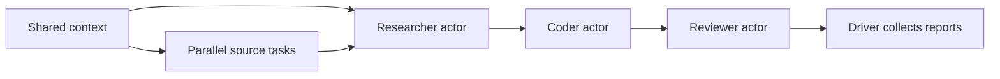

# Learn Ray step by step

## What is Ray?

Ray is an open-source framework for running Python work across multiple processes
on one computer or across multiple computers in a cluster. You identify functions
and classes that can run remotely, and Ray coordinates their execution, resource
allocation, and exchange of results. This lets you start with a local program and
use the same task and actor APIs as you move to a larger cluster.

Ray is useful when a program has independent work that can overlap: processing
many files, running simulations, fetching sources, or coordinating model inference
and other stages of an AI workflow. You still decide how to divide the work and
which results depend on others. Adding Ray to a program does not automatically
make every operation parallel or faster.

This repository teaches **Ray Core**, the execution layer built around tasks,
actors, and objects. The wider Ray ecosystem also includes libraries for data
processing, model training, tuning, and serving. Start with the
[official Ray Core overview](https://docs.ray.io/en/latest/ray-core/walkthrough.html)
for the foundation used throughout these lessons.

## How Ray works

### The main building blocks

| Concept | What it does | Example in this repository |
| --- | --- | --- |
| **Driver** | Your main Python program; submits work and collects results. | A lesson script or the workflow CLI. |
| **Task** | A function invocation executed on a Ray worker process. Use tasks for independent units of computation. | Squaring a number or fetching an offline source. |
| **Actor** | A dedicated worker process holding a class instance. Its methods can update state that persists between calls. | A counter or the Researcher, Coder, and Reviewer personas. |
| **ObjectRef** | A reference to a result that may still be computing. Pass it to other tasks or retrieve its value later. | The reference returned by `square.remote(7)`. |
| **Object store** | Ray's system for sharing immutable data between workers, with a shared-memory store on each node. | Shared workflow context created with `ray.put()`. |

These primitives let you combine independent tasks with services that keep state.
An actor's state belongs to that actor instance; ordinary Python globals do not
become shared state across worker processes. See Ray's
[key concepts](https://docs.ray.io/en/latest/ray-core/key-concepts.html).

### From a Python call to a remote result

After installing the project using the setup instructions below, this small
example shows the execution flow:

```python
import ray


@ray.remote(num_cpus=1)
def square(number):
    return number * number


if __name__ == "__main__":
    ray.init(num_cpus=2, include_dashboard=False)
    try:
        # Submit both tasks before waiting for either result.
        first_ref = square.remote(7)
        second_ref = square.remote(9)
        print(ray.get([first_ref, second_ref]))  # [49, 81]
    finally:
        ray.shutdown()
```

1. **Start the runtime.** Here, `ray.init()` starts Ray locally, including worker
   processes and services for scheduling and managing objects. The script remains
   the driver. A driver can also connect to an existing cluster.
2. **Submit work.** `@ray.remote` defines a remote function.
   `square.remote(7)` submits a task and returns an `ObjectRef` without waiting
   for the calculation to finish. The second submission can proceed immediately.
3. **Schedule execution.** Ray places tasks on workers where their requested
   logical resources are available. With two logical CPUs and one requested per
   task, these two tasks can run concurrently in separate worker processes.
4. **Resolve results.** `ray.get()` waits as needed and retrieves the values.
   Passing a list returns results in that list's order, regardless of which task
   finished first. `ray.wait()` instead lets you select ready references.
5. **Disconnect.** `ray.shutdown()` disconnects the driver and, for the local
   runtime started here, terminates its Ray processes.

CPU and GPU requests guide scheduling. For example, `num_cpus=1` reserves one
logical CPU for a task; it does not enforce a physical CPU usage limit. See
[Ray resource scheduling](https://docs.ray.io/en/latest/ray-core/scheduling/resources.html).

### Share data and express dependencies

Use `ray.put(data)` to create a shared object once and pass its reference to
multiple tasks. Ray moves object data between nodes when needed. Shared objects
are immutable; return a new object to represent a transformation.

You can also pass one task's result reference directly as a top-level argument to
another task. Ray waits for the upstream result and supplies its value before
executing the dependent task. This forms a dependency graph without making the
driver retrieve every intermediate value. References nested inside a list or
dictionary remain references and must be resolved explicitly. See the
[objects guide](https://docs.ray.io/en/latest/ray-core/objects.html).

The workflow in this repository applies these ideas as follows:



The three persona actors each keep an event history. Their async methods can
overlap requests while awaiting work, so multiple requests can make progress
inside one actor process. This differs from tasks running on separate processes.

### Local execution, clusters, and practical limits

A Ray cluster has one **head node** and can have additional **worker nodes**.
Each node provides processes and memory for executing work and sharing objects;
the head also runs cluster management services. A single computer can be the
entire cluster, as in the local lessons here. A worker node is a machine or pod,
while a worker process executes Python code on that node. See
[Ray cluster concepts](https://docs.ray.io/en/latest/cluster/key-concepts.html).

Parallelism helps when useful work outweighs startup, scheduling, serialization,
and data transfer costs. Tiny calculations such as squaring a number demonstrate
the API; they usually do not benefit from distributing the work. Submit
independent tasks before waiting for results to give Ray an opportunity to run
them concurrently.

Remote work can also fail. A Python exception in a task surfaces through its
result, typically as `RayTaskError` when you call `ray.get()`. Retry settings
control recovery behavior; retries do not fix invalid inputs or guarantee that
an external side effect happens only once. See
[task fault tolerance](https://docs.ray.io/en/latest/ray-core/fault_tolerance/tasks.html).

## About these lessons

Learn Ray by running small Python programs, then combine them into an actor
workflow, inspect it in the dashboard, and optionally run it on GCP. Each lesson
builds on the previous one and includes an experiment to try yourself.

You need basic Python knowledge: functions, classes, lists, and exceptions. The
local lessons use CPUs and offline sample data. No cloud account, GPU, or API key
is required. The Researcher, Coder, and Reviewer personas use deterministic Python
logic; Gemma model integration is a future extension.

## Learning path

| Step | Topic | File |
| --- | --- | --- |
| 1 | Remote tasks and result references | [01_remote_tasks.py](01_basics/01_remote_tasks.py) |
| 2 | Submit tasks in parallel | [02_parallel_tasks.py](01_basics/02_parallel_tasks.py) |
| 3 | Share objects and connect task dependencies | [03_shared_objects.py](01_basics/03_shared_objects.py) |
| 4 | Keep state in actors | [04_stateful_actors.py](01_basics/04_stateful_actors.py) |
| 5 | Collect ready results and handle failures | [05_wait_and_errors.py](01_basics/05_wait_and_errors.py) |
| 6 | Combine tasks and actors into a workflow | [run.py](02_workflows/run.py) |
| 7 | Inspect workers, actors, and tasks | [inspect_dashboard.py](03_observability/inspect_dashboard.py) |
| 8 | Optional: run on a cloud VM | [gcp_showcase.py](04_gcp_deployment/gcp_showcase.py) |

## Set up your environment

This project requires **Python 3.10, 3.11, or 3.12** and pins **Ray 2.59.0** in
[pyproject.toml](pyproject.toml). Open a terminal in the repository root.

**Windows PowerShell:**

```powershell
py -3.12 -m venv .venv
.\.venv\Scripts\Activate.ps1
python -m pip install --upgrade pip
python -m pip install -e ".[dev]"
```

**macOS or Linux:**

```bash
python3.12 -m venv .venv
source .venv/bin/activate
python -m pip install --upgrade pip
python -m pip install -e ".[dev]"
```

Substitute another supported Python version if needed. If PowerShell blocks
activation, use `.\.venv\Scripts\python.exe` in place of `python` for subsequent
commands, including the two pip commands above.

Check the installation:

```bash
python -c "import ray; print(ray.__version__)"
```

Expected version: `2.59.0`. Run all lesson commands below from the repository
root with this environment active. Each basics script starts a local Ray runtime
with two logical CPUs and shuts it down when finished.

## Step 1: Run your first remote task

```bash
python 01_basics/01_remote_tasks.py
```

Read the file while following these operations:

1. `ray.init()` starts the local runtime. Your main Python program is the **driver**.
2. `@ray.remote` makes `square` available as a task on a Ray worker.
3. `square.remote(7)` submits the task and returns an **ObjectRef**, a reference
   to its eventual result.
4. `ray.get(result_ref)` waits for that result and retrieves its value.
5. `ray.shutdown()` disconnects the driver and stops its local runtime.

Look for `Reference type: ObjectRef` and `square(7) = 49` among the startup logs.

**Try it:** change the input to `9`. Predict the result before running again.

## Step 2: Submit independent tasks in parallel

```bash
python 01_basics/02_parallel_tasks.py
```

The script submits four tasks before retrieving their results:

```python
pending = [slow_square.remote(number) for number in range(4)]
results = ray.get(pending)
```

Expect `Squares: [0, 1, 4, 9]` and worker process IDs. Each task requests one
logical CPU, so the two-CPU runtime can schedule two of these tasks at a time.
`ray.get()` on a list preserves the order of the input references.

**Try it:** put `ray.get(slow_square.remote(number))` inside the submission loop
and compare the task timestamps. Waiting after each submission makes that loop
serial. Restore the original code afterward. The artificial delay makes overlap
visible; runtime startup and scheduling overhead can dominate tiny computations.

## Step 3: Share data and connect task dependencies

```bash
python 01_basics/03_shared_objects.py
```

`ray.put([1, 2, 3, 4])` stores input in Ray's object store and returns a reference.
The script reuses it in two tasks, then passes one task's output reference
directly to another task:

```python
numbers_ref = ray.put([1, 2, 3, 4])
totals = [total.remote(numbers_ref) for _ in range(2)]
scaled_ref = scale.remote(totals[0], 10)
```

Ray resolves a reference passed as a top-level task argument before running the
task. The driver can connect these dependencies without retrieving intermediate
values. Shared objects are immutable; workers should return new values when
transforming them.

Expect `Shared totals: [10, 10]` and `Dependent result: 100`.

**Try it:** add `5` to the shared input. Both totals should become `15`, and the
scaled result should become `150`.

## Step 4: Keep state in an actor

```bash
python 01_basics/04_stateful_actors.py
```

A task runs a function. An **actor** is a worker holding an instance of a class,
with state that persists between method calls. `Counter.remote()` creates an
actor; `counter.increment.remote()` submits a method call to it.

Expect `First counter: [1, 2, 3]; second counter: 0`. The two counters have
independent state. This synchronous actor executes this driver's calls in
submission order. The script terminates its actors with `ray.kill()` afterward.

**Try it:** change each increment to `first.increment.remote(2)`. The first
counter should return `[2, 4, 6]`, while the second remains `0`.

## Step 5: Process ready results and handle a failed task

```bash
python 01_basics/05_wait_and_errors.py
```

`ray.wait()` separates ready references from pending ones so you can process
completed work without retrieving the whole batch together. It does not retrieve
values or catch task errors; `ray.get()` retrieves each value and raises
`RayTaskError` for the failed division.

One task deliberately divides by zero. Expect a handled-error message followed
by `Successful values (sorted): [4.0, 6.0]; failed tasks: 1`. This is a successful
lesson run. The example disables task retries with `max_retries=0`.

**Try it:** replace the zero denominator with `4`. You should get three
successful values and no failed tasks. Restore zero to practice the error path.

## Step 6: Build a workflow with tasks and actors

```bash
python 02_workflows/run.py --jobs 3
```

This combines the concepts from the first five lessons:

1. Store one shared context object with `ray.put()`.
2. Fetch three offline sources through parallel `fetch_tool` tasks.
3. Submit topic requests to a Researcher actor.
4. Send each research result to a Coder actor, then its implementation to a
   Reviewer actor.
5. Retrieve the results and write `artifacts/run.json`.

Expect `Approved 3/3 reports; sources 3/3`. Open the JSON report and compare
`context.context_id` with the source `context_id` values. Inspect `actor_events`
for each persona's process ID, node ID, and timestamps.

Read [runtime.py](src/gemma_ray/runtime.py) for the Ray wiring and
[personas.py](src/gemma_ray/personas.py) for the persona logic. These actors use
async methods: awaiting work lets other requests make progress in the same actor.
References nested in `source_refs` remain references and are explicitly awaited.

**Try it:** run `python 02_workflows/run.py --jobs 6 --delay 1` and inspect the
overlapping event timestamps. Async overlap can occur within one actor process;
it does not imply six separate worker processes.

For all options, run `python 02_workflows/run.py --help`. You can also use the
installed `gemma-ray` command or `python -m gemma_ray.cli`.

## Step 7: Inspect the Ray dashboard

In your first terminal, keep the workflow alive for five minutes:

```bash
python 02_workflows/run.py --dashboard --jobs 6 --delay 2 --hold-seconds 300
```

Open [the local dashboard](http://127.0.0.1:8265). If prompted for a token, run
`ray get-auth-token` in a second terminal with the same environment active and
paste the token into the dashboard. See the official
[token authentication guide](https://docs.ray.io/en/latest/ray-security/token-auth.html).

While the first command is still running, use the second terminal to inspect it:

```bash
python 03_observability/inspect_dashboard.py
```

Expect `Dashboard HTTP: 200`, named actors `Researcher`, `Coder`, and `Reviewer`,
and task names. In the dashboard, find those actors, inspect their worker
processes and logs, and compare them with `artifacts/run.json`. The inspector
enables local token authentication for its State API calls automatically.

**Try it:** explain which records represent source-fetch tasks and which
represent actor method calls. Let the hold expire, or press Ctrl+C in the first
terminal when finished. The driver then shuts down its local runtime.

## Step 8: Optional cloud deployment

After completing the local lessons, explore
[the GCP launcher](04_gcp_deployment/gcp_showcase.py). It runs Ray on a single
Compute Engine VM and supports a CPU profile or an L4 GPU profile. The optional
GPU task performs a small PyTorch linear-model calculation with fixed weights.

Start with a preview, which makes no cloud calls:

```bash
python 04_gcp_deployment/gcp_showcase.py plan --project YOUR_PROJECT_ID --profile cpu
```

Before provisioning, read [the GCP session guide](docs/gcp-showcase.md) for
authentication, quota, pricing, bootstrap checks, SSH access, and cleanup. Its
`scripts/gcp_showcase.py` references correspond to
`04_gcp_deployment/gcp_showcase.py` in this layout.

The session order is `plan`, `create`, wait for bootstrap readiness, `upload`,
`run`, `tunnel` in another terminal, `fetch`, then `delete`. Use the same project,
zone, instance, and profile throughout. Creating a VM incurs cloud charges;
delete it after collecting your results and verify that its disks were removed.
The launcher's scheduled deletion is a fallback for explicit cleanup.

## Check your understanding

After restoring any lesson experiments, run the automated checks:

```bash
python -m pytest -m "not integration"
python -m pytest -m integration
```

The first command checks helpers, CLI validation, and deployment command
construction. The second starts real local Ray workers to exercise the five
basics lessons and the actor workflow. Neither command provisions cloud resources.

You are ready to extend the project when you can explain when to use a task or
an actor, how an ObjectRef differs from its value, why submission order affects
parallelism, and where a remote exception surfaces.

For a notebook-based workflow, open [ray_lab.ipynb](notebooks/ray_lab.ipynb) in
Colab with a supported Python runtime. It installs this project from an uploaded
repository ZIP and runs the actor workflow. Use its JSON output to inspect the
run; use the local or GCP workflow for dashboard access.

For the underlying concepts, continue with the official
[Ray Core walkthrough](https://docs.ray.io/en/latest/ray-core/walkthrough.html).

## Troubleshooting

| Symptom | What to check |
| --- | --- |
| `ModuleNotFoundError: gemma_ray` | Use the intended virtual environment and rerun `python -m pip install -e ".[dev]"` from the repository root. |
| Installation fails with an unsupported Python version | Check `python --version`; recreate the environment with Python 3.10 through 3.12. |
| The dashboard is unavailable | Start the Step 7 command with `--dashboard` and inspect it before the hold expires. Check whether another process is using port 8265. |
| Lesson 5 prints a division-by-zero error | This is the intentional failure; look for the handled-error message and two successful values. |
| Tiny tasks do not run faster | Compare worker timestamps; startup, scheduling, and data transfer add overhead. |
| `--gpu` reports no GPU resources | Run the CPU workflow without that flag, or configure a CUDA-capable environment with the optional `gpu` dependencies. |
